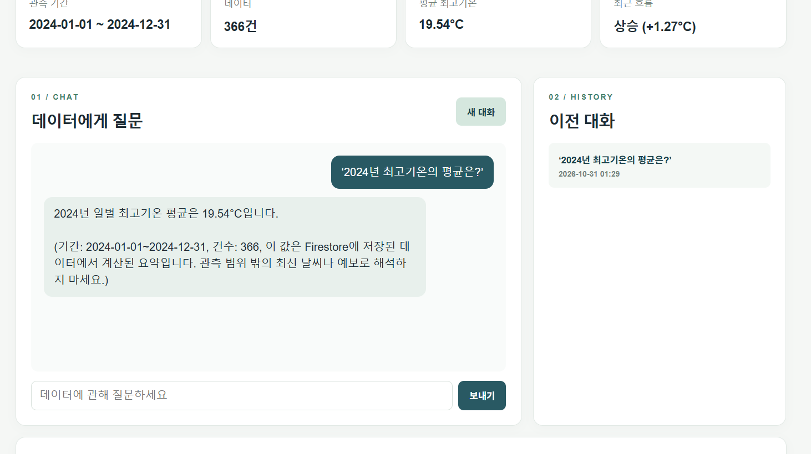

# 서울 기온 데이터 AI 프로젝트 보고서

작성일: 2026년 10월 31일  
프로젝트: [GitHub 저장소](https://github.com/daguri2963/seoul-weather-ai) · [웹 서비스](https://seoul-weather-ai-frontend.vercel.app) · [API 문서](https://seoul-weather-ai.onrender.com/docs)

## 1. 프로젝트 개요

이 프로젝트는 **내 데이터를 이해하고 답하는 AI 서비스**를 만드는 과제입니다. 기존 시계열 분석 저장소의 기상청 서울 ASOS 108 지점 자료를 재사용해, 2024년 **일별 최고기온 366건**을 Firestore에 저장했습니다. FastAPI가 저장 데이터를 읽어 요약하고, 그 요약을 Codyssey의 OpenAI 호환 채팅 API에 전달합니다. 사용자는 바닐라 JavaScript 웹 화면에서 질문하고, 데이터를 관리하고, 이전 대화를 다시 열 수 있습니다.

이 서비스의 `value`는 하루의 **최고기온**입니다. 보고서의 최솟값 −8.2°C는 366개 *일별 최고기온* 중 가장 낮은 값이지, 2024년의 최저기온 관측값이 아닙니다. 기존 저장소의 강수 분석 결론은 이 서비스의 기온 요약에 섞지 않았습니다.

## 2. 발표 원고

### 도입: 어떤 문제를 해결했나

일반적인 AI에게 “내 데이터의 평균이 얼마야?”라고 물으면, AI는 제 데이터베이스를 읽을 수 없으므로 정확한 답을 줄 수 없습니다. 저는 실제 데이터에서 계산한 수치를 AI에게 제공하는 서비스를 만들었습니다. 대상은 기상청 서울 ASOS 108 지점의 2024년 일별 최고기온 366건입니다. 기존에 분석했던 자료에서 필요한 열을 재사용했고, 날짜·기온·메모 형태로 저장했습니다.

### 데이터 분석: 어떤 정보를 만들었나

서버는 Firestore의 현재 데이터를 날짜순으로 정렬한 뒤 관측 기간, 건수, 평균, 최대, 최소를 계산합니다. 현재 366건의 기간은 2024년 1월 1일부터 12월 31일까지이고, **일별 최고기온의 평균은 19.54°C**, 가장 높은 값은 **36.4°C**, 가장 낮은 값은 **−8.2°C**입니다. 최근 흐름은 마지막 7건의 평균과 그 직전 7건의 평균 차이로 표시합니다. 차이가 +0.5°C를 넘으면 상승, −0.5°C보다 작으면 하락, 그 사이는 보합입니다. 현재 화면에는 상승 **+1.27°C**로 표시됩니다. 이 수치는 두 구간을 비교한 지표이며 날씨 예보가 아닙니다.

### 서비스 구조: 데이터가 답변이 되는 과정

사용자가 질문하면 웹 화면이 FastAPI의 `/api/chat`에 요청을 보냅니다. 서버는 Firestore에서 데이터를 다시 읽고 요약을 계산합니다. 이어서 요약 수치를 시스템 메시지에 넣고 사용자 질문과 함께 Codyssey의 OpenAI 호환 API에 전달합니다. AI 답변이 돌아오면 질문과 답변을 Firestore의 `conversations` 컬렉션에 저장하고 화면에 보여 줍니다. 따라서 데이터가 바뀌면 다음 질문에는 다시 계산한 요약이 반영됩니다. AI는 요약 수치를 바탕으로 설명하지만, 요약에 없는 특정 날짜의 관측값이나 미래 날씨는 추측하지 않도록 지시했습니다.

```text
사용자 질문 → Vercel 웹 화면 → Render/FastAPI → Firestore 데이터 조회·요약
                                            ↓
                              Codyssey AI에 요약과 질문 전달
                                            ↓
                          답변과 대화를 Firestore에 저장 → 화면 표시
```

### 데이터 관리와 대화 기록

데이터에는 `POST`, `GET`, `PUT`, `DELETE` API를 구현했습니다. 날짜를 문서 ID로 사용하므로 같은 날짜를 중복 등록하면 409 오류가 납니다. 입력은 Pydantic으로 검증합니다. 예를 들어 날짜 형식이 틀리거나 값이 −100~100°C 범위를 벗어나면 저장하기 전에 요청을 거절합니다. 데이터가 수정·삭제되면 다음 요약과 AI 답변에 변경 사항이 반영됩니다.

대화는 Firestore의 `conversations` 컬렉션에 제목, 메시지, 생성·수정 시각을 저장합니다. 대화 목록은 가볍게 제목과 시각을 조회하고, 사용자가 하나를 선택하면 해당 메시지를 다시 불러옵니다. 이어서 질문할 때는 최근 메시지 최대 10개를 AI 문맥에 포함합니다.

### 기술 선택과 배포

백엔드는 FastAPI의 라우터를 데이터·대화·채팅으로 나누고, Firestore 작업과 요약 계산은 서비스 코드로 분리했습니다. 이 구조 덕분에 HTTP 요청 처리와 데이터 처리 책임을 구분할 수 있습니다. FastAPI가 생성하는 Swagger UI는 `/docs`에서 확인할 수 있습니다. 프론트엔드는 HTML·CSS·바닐라 JavaScript로 만들었고, 질문 전송 중에는 로딩 표시를 보여 줍니다.

백엔드는 Render 무료 웹 서비스, 프론트엔드는 Vercel 무료 정적 사이트에 배포했습니다. 서로 다른 주소에서 통신하므로 FastAPI의 CORS 허용 출처에 Vercel 주소를 설정했습니다. Codyssey 가상 키와 Firebase 서비스 계정은 서버 환경 변수에만 저장하고 GitHub나 프론트엔드 코드에는 넣지 않았습니다. 배포된 API는 별도의 접근 토큰으로 보호합니다. 웹 화면의 토큰은 해당 브라우저 탭의 세션 저장소에 보관됩니다.

### 검증과 결과

자동 테스트 4개로 요약 계산, 요청 검증, 요약의 AI 프롬프트 주입과 대화 저장, 접근 토큰을 확인했습니다. 실제 Firestore에서는 임시 데이터 한 건을 추가·수정·조회·삭제한 후 366건으로 복구된 것을 확인했습니다. 배포된 웹 화면에서 질문 “2024년 최고기온의 평균은?”에 **19.54°C**라는 AI 답변이 표시됐고, 대화 목록에 저장됐습니다. 저장된 대화를 API로 다시 조회해 질문과 답변 메시지 2개를 확인했습니다. Render의 상태 확인 경로와 Swagger 문서도 정상 응답했습니다.

## 3. 요구사항별 구현 결과

| 요구사항 | 구현 및 확인 내용 |
|---|---|
| 시계열 데이터 100건 이상 | 기상청 서울 2024년 일별 최고기온 366건 |
| 분석과 요약 | 기간·건수·평균·최대·최소·최근 7건 흐름 |
| 데이터 기반 AI 채팅 | 저장 데이터의 요약을 시스템 메시지에 주입, 로딩 표시와 답변 출력 |
| Firestore CRUD | `data` 컬렉션의 추가·목록·수정·삭제와 Pydantic 검증 |
| 대화 기록 | `conversations` 컬렉션의 저장·목록·불러오기 |
| FastAPI와 문서 | 라우터·서비스 분리, `/docs` Swagger UI |
| 배포와 설정 | Render·Vercel 무료 플랜, CORS, 서버 환경 변수, 접근 토큰 |

## 4. 과제 목표 6가지: 직접 설명하는 답변

### ① 시계열 분석 결과가 서비스에 쓰이는 흐름

**설명할 말:** “시계열 데이터는 날짜에 따라 값이 달라지는 데이터입니다. 저는 서울의 2024년 일별 최고기온을 날짜와 값으로 정리해 366건을 Firestore에 저장했습니다. 사용자가 화면을 열거나 질문할 때 서버가 저장된 데이터를 날짜순으로 읽어 기간·건수·평균·최대·최소·최근 흐름을 계산합니다. 계산 결과는 화면의 요약 카드와 AI의 답변 근거로 함께 사용됩니다.”

**코드와 연결:** `backend/app/services/summary.py`의 `summarize()`가 날짜순 정렬과 통계 계산을 담당합니다. 최근 흐름은 마지막 7건 평균에서 그 직전 7건 평균을 뺀 값입니다. 데이터가 14건보다 적으면 가능한 절반 크기의 구간을 쓰고, 비교할 구간이 없으면 흐름을 ‘자료 부족’으로 표시합니다. 서버가 요청 때마다 Firestore를 다시 읽기 때문에 데이터 관리 화면의 변경이 다음 요약에 반영됩니다.

### ② FastAPI를 라우터와 서비스로 나눈 기준

**설명할 말:** “사용자가 어떤 주소로 무엇을 요청하는지 처리하는 부분과, 실제 데이터를 읽고 계산하는 부분을 나눴습니다. `routers/data.py`는 데이터 API, `routers/conversations.py`는 대화 API, `routers/chat.py`는 AI 채팅 API를 맡습니다. Firestore 읽기·쓰기는 `services/store.py`, 통계 계산은 `services/summary.py`에 둡니다. 그래서 저장 방식이나 계산 규칙을 바꿀 때 관련 코드만 찾으면 됩니다.”

**코드와 연결:** `main.py`는 앱 생성, CORS, 접근 토큰 검사, 라우터 등록을 맡고, `db.py`는 Firebase Admin SDK 연결을 담당합니다. 라우터는 요청을 받아 서비스를 호출하고 응답을 반환합니다. 이 분리는 기능별 책임을 분명히 하고 테스트할 때 Firestore 작업과 요약 계산을 각각 확인하기 쉽게 합니다.

### ③ Pydantic 요청 검증을 쓴 이유와 방식

**설명할 말:** “사용자가 잘못된 날짜나 숫자를 보내면 데이터베이스에 저장하기 전에 막아야 합니다. FastAPI가 Pydantic 모델로 요청 본문을 검사하게 했습니다. 예를 들어 날짜는 `date` 형식이어야 하고, 기온 값은 유한한 숫자이며 −100~100°C 범위여야 합니다. 메모는 최대 500자입니다. 조건을 어기면 API가 422 오류를 반환합니다.”

**코드와 연결:** `backend/app/models.py`의 `DataInput`, `ChatInput`, `ConversationInput`이 입력 규칙입니다. `extra="forbid"`로 정의되지 않은 필드도 거절합니다. 채팅 질문은 1~1000자, 대화 메시지의 역할은 `user` 또는 `assistant`만 허용합니다. 검증은 API 입력의 기본 안전장치이며, 실제 데이터의 의미가 맞는지까지 자동으로 보장하지는 않습니다.

### ④ Firestore 저장과 CRUD 방법

**설명할 말:** “Firestore에는 `data`와 `conversations` 두 컬렉션을 만들었습니다. `data`의 문서 ID는 `YYYY-MM-DD` 날짜로 정해 같은 날의 중복 저장을 막습니다. 추가는 문서 `create`, 목록은 컬렉션 `stream`, 수정은 문서 `set`, 삭제는 문서 `delete`를 사용합니다. 수정·삭제 전에 해당 문서가 있는지 확인하고, 없는 문서는 404 오류로 알립니다.”

**코드와 연결:** 이 작업은 `backend/app/services/store.py`에 있습니다. 기존 날짜를 다시 추가하면 409 오류입니다. 대화는 자동 생성된 문서 ID로 저장하며 제목·메시지·생성 시각·수정 시각을 포함합니다. 목록 API는 메시지를 제외해 보내고, 개별 대화 조회 API가 전체 메시지를 반환합니다. 브라우저가 Firestore에 직접 접속하지 않고 FastAPI 서버가 Firebase Admin SDK로 접속합니다.

### ⑤ 데이터 요약을 시스템 프롬프트에 주입하는 원리

**설명할 말:** “AI 모델은 제 Firestore 내용을 원래 알지 못합니다. 질문을 받을 때 서버가 현재 데이터를 요약하고, ‘기간은 2024년, 건수는 366건, 평균은 19.54°C’ 같은 정보를 시스템 메시지에 넣습니다. 그 메시지와 사용자 질문을 함께 Codyssey의 AI API에 보내므로 모델이 저장 데이터에 맞는 답을 할 수 있습니다. 이것이 이 프로젝트의 컨텍스트 주입입니다.”

**코드와 연결:** `backend/app/routers/chat.py`의 `build_system_prompt()`가 요약을 문장으로 만들고, `chat()`이 시스템 메시지를 맨 앞에 배치합니다. 이후 이전 대화의 최근 메시지 최대 10개와 새 질문을 추가합니다. AI가 데이터베이스를 직접 조회하는 구조는 아닙니다. 프롬프트에는 요약만 있으므로 특정 날짜의 정확한 값이나 미래 예보를 모르면 추측하지 말라고 지시합니다. 답변을 받으면 질문·답변을 Firestore에 저장합니다.

### ⑥ 배포 때 CORS·환경 변수·키 관리가 필요한 이유

**설명할 말:** “웹 화면은 Vercel 주소에서, API는 Render 주소에서 실행됩니다. 주소가 달라 브라우저가 기본적으로 API 응답을 읽지 못할 수 있으므로, 서버의 CORS 설정에 허용할 Vercel 출처를 명시했습니다. Codyssey 키와 Firebase 서비스 계정은 공개 웹 코드나 GitHub에 넣으면 유출될 수 있으므로 Render 환경 변수에만 둡니다. 배포마다 주소와 키가 달라질 수 있어 환경 변수로 분리했습니다.”

**코드와 연결:** `main.py`가 CORS와 `/api/` 접근 토큰 검사를 설정하고, `config.py`가 `ALLOWED_ORIGINS`를 읽습니다. 프론트엔드의 `API_BASE_URL`은 공개 가능한 API 주소만 담습니다. `OPENAI_API_KEY`와 `FIREBASE_SERVICE_ACCOUNT_JSON`은 서버 전용입니다. CORS는 어떤 웹 출처가 응답을 읽을지 정하는 브라우저 규칙이며 사용자 인증을 대신하지 않습니다. 현재 공용 접근 토큰은 과제용 보호 방식이므로 여러 사용자용 서비스라면 개인별 인증이 필요합니다.

## 5. 시연 순서

1. [웹 서비스](https://seoul-weather-ai-frontend.vercel.app)를 열고 관측 기간, 366건, 평균 19.54°C를 설명합니다. 접근 토큰이 필요한 경우 화면에서만 입력하고 공개하지 않습니다.
2. “2024년 최고기온의 평균은?”을 보내 로딩 표시와 데이터 기반 답변을 보여 줍니다.
3. 오른쪽 ‘이전 대화’에서 방금 저장된 대화를 선택해 메시지가 다시 표시되는지 보여 줍니다.
4. 데이터 관리 화면에서 임시 날짜 한 건을 추가하고 수정 결과를 보여 준 뒤 삭제해 원래 366건으로 되돌립니다. 원본 관측값은 수정하지 않습니다.
5. [Swagger UI](https://seoul-weather-ai.onrender.com/docs)에서 데이터·대화·채팅 API 경로를 보여 줍니다.



## 6. 예상 질문과 답변

**Q1. 왜 AI가 데이터베이스를 직접 읽게 하지 않았나요?**  
A. 서버에서 필요한 통계를 먼저 계산해 전달하면 어떤 수치가 답변의 근거인지 설명할 수 있고, AI에게 Firestore 접근 권한을 줄 필요가 없습니다. 현재 채팅은 이 요약 범위 안에서 답하도록 설계했습니다.

**Q2. 19.54°C는 2024년 서울의 평균 기온인가요?**  
A. 정확히는 366개 **일별 최고기온의 산술평균**입니다. 일평균 기온이나 일별 최저기온의 평균과는 다릅니다.

**Q3. −8.2°C는 2024년 최저기온인가요?**  
A. 아닙니다. 수집한 ‘일별 최고기온’ 366개 중 최솟값입니다. 해당 연도의 실제 최저기온을 알려면 별도의 최저기온 자료가 필요합니다.

**Q4. 최근 흐름의 ‘상승 +1.27°C’는 장기 온난화를 뜻하나요?**  
A. 아닙니다. 마지막 7건 평균과 직전 7건 평균의 차이일 뿐입니다. 짧은 기간의 상대 변화이고 계절 변화나 기후 추세를 입증하지 않습니다.

**Q5. 데이터가 수정되면 AI 답변도 바뀌나요?**  
A. 다음 채팅 요청 때 Firestore를 다시 읽어 요약을 계산하므로 바뀐 데이터가 반영됩니다. 이미 저장된 과거 답변을 자동으로 다시 쓰지는 않습니다.

**Q6. Pydantic을 사용한 이유는 무엇인가요?**  
A. 날짜와 숫자 형식, 값의 범위, 메모 길이, 메시지 역할 등을 API 진입점에서 검증하기 위해서입니다. 잘못된 입력은 Firestore에 저장되기 전에 422 응답으로 거절합니다.

**Q7. CORS와 접근 토큰은 각각 무슨 역할인가요?**  
A. CORS는 Vercel 주소의 웹 페이지가 Render API 응답을 브라우저에서 읽도록 허용합니다. 접근 토큰은 `/api/` 요청에 필요한 별도 인증값입니다. CORS만으로 API를 보호할 수는 없습니다.

**Q8. 비밀키는 어디에 있나요?**  
A. Codyssey 가상 키와 Firebase 서비스 계정은 Render의 서버 환경 변수에 둡니다. 로컬 `.env`와 키 파일은 Git에서 제외했습니다. 웹 화면의 빌드 설정에는 공개 가능한 Render 주소만 넣습니다.

**Q9. 이 서비스가 답할 수 없는 질문은 무엇인가요?**  
A. 현재 AI에는 전체 데이터 행이 아닌 요약만 전달됩니다. 따라서 특정 날짜의 정확한 값, 강수와 기온의 인과관계, 미래 예보는 이 설계만으로 확정할 수 없습니다. 필요한 경우 해당 질문에 맞는 조회 기능과 분석을 추가해야 합니다.

**Q10. 비용 없이 계속 사용할 수 있나요?**  
A. 현재 Render와 Vercel은 무료 플랜으로 설정했습니다. Firebase는 Spark 무료 프로젝트를 사용합니다. Codyssey 호출에는 가상 키의 사용량 한도가 있으므로 콘솔에서 잔여량을 확인해야 합니다. 무료 서비스는 휴면 뒤 첫 응답이 늦어질 수 있습니다.

**Q11. 실제로 동작한다는 근거는 무엇인가요?**  
A. 로컬 자동 테스트 4개가 통과했고, 실제 Firestore CRUD와 대화 불러오기를 확인했습니다. 배포된 화면에서 AI가 평균 19.54°C라고 답하고 해당 대화가 목록에 저장되는 것도 확인했습니다. 검증 화면은 위 이미지와 저장소 README에 있습니다.

## 7. 한계와 다음 개선

현재 서비스는 과제용 단일 데이터셋과 공용 접근 토큰을 사용합니다. 여러 사용자가 독립적으로 쓸 서비스라면 개인별 로그인과 데이터 권한 분리가 필요합니다. AI가 받는 것은 요약이므로 특정 날짜 조회나 더 복잡한 비교 질문을 지원하려면 서버의 조회 API를 확장해야 합니다. Render 무료 인스턴스가 휴면 상태에서 깨어날 때에는 첫 요청이 지연될 수 있습니다.

자료 출처: [기존 시계열 분석 저장소와 원자료 안내](https://github.com/daguri2963/seoul-rain-temperature-analysis#출처와-이용-조건). 실제 실행·환경 변수 설명은 이 프로젝트의 [README](https://github.com/daguri2963/seoul-weather-ai#readme)를 참조하세요.
